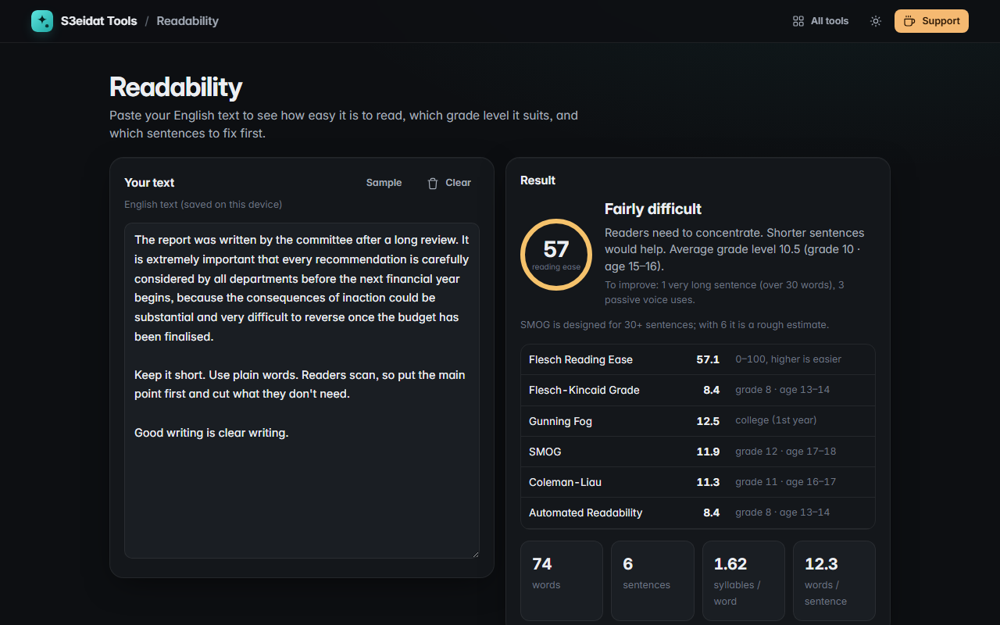

# Readability

> Check how easy your writing is to read. Free, private, and it runs entirely in your browser.

### ▶ [Open Readability](https://s3eidat.github.io/readability/)



## Features

- Six classic scores, live as you type:
  **Flesch Reading Ease**, **Flesch-Kincaid Grade**, **Gunning Fog**, **SMOG**, **Coleman-Liau** and the
  **Automated Readability Index**, each with its US grade level and reader age
- A **plain-words verdict** (“Plain English”, “Difficult”…) with what to fix first
- **Highlights**: long sentences (over 20 words) and very long ones (over 30), **passive voice** and **adverbs**,
  each toggleable, with counts
- Handles abbreviations (Dr., e.g., J. K.) and decimals when splitting sentences
- Words, sentences, syllables per word and words per sentence
- Your text is saved on this device

The formulas are made for **English**. Syllables are estimated with rules (no dictionary) and passive voice and
adverbs are found by pattern, so treat the results as a guide. Arabic text gets a notice instead of fake precision.

## Privacy

Your text never leaves your device. There is no server, no account, no analytics.
The page ships with a strict Content-Security-Policy (`connect-src 'self'`), so the browser
itself blocks any attempt to send data anywhere.

## Run it yourself

It's plain HTML, CSS and JavaScript with no build step:

```bash
git clone https://github.com/s3eidat/readability
cd readability
python -m http.server 8000
```

Then open http://localhost:8000.

## Support

If this saved you time, **[buy me a coffee ☕](https://s3eidat.github.io/coffee/)**. It keeps every tool free.

---

Part of **[S3eidat Tools](https://s3eidat.github.io/)**: 100+ free, private tools that run in your browser. MIT licensed.
